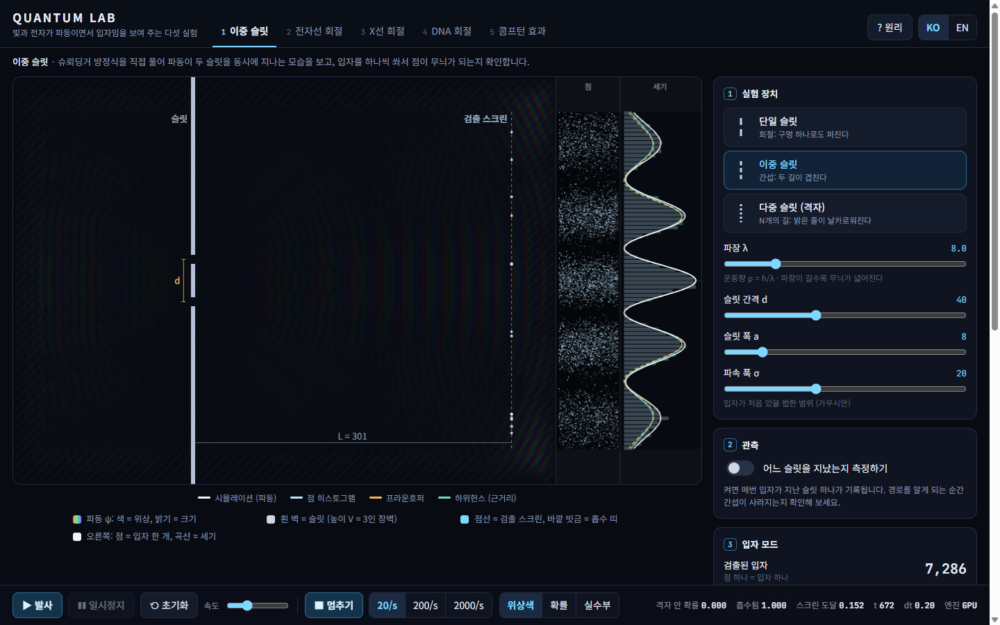
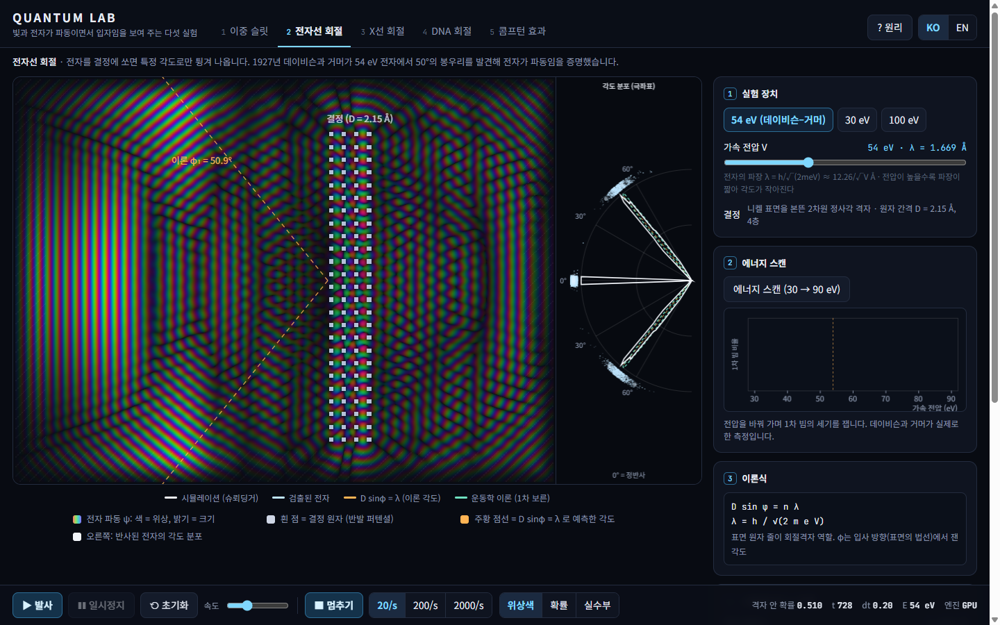
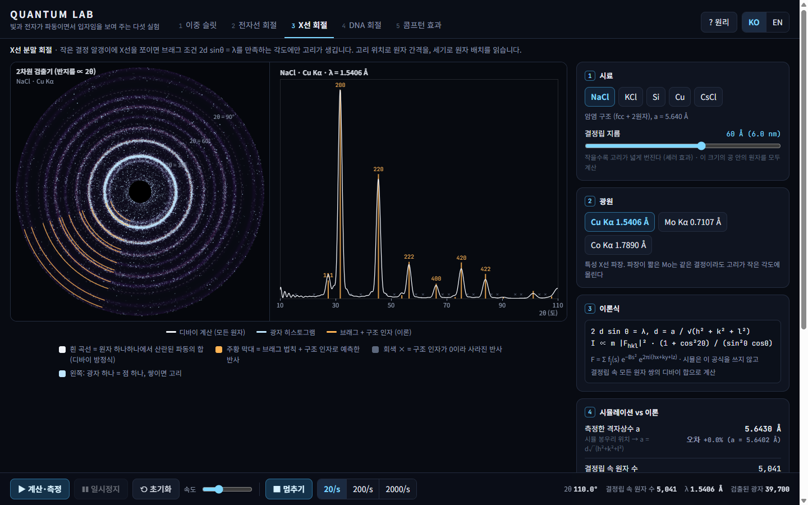
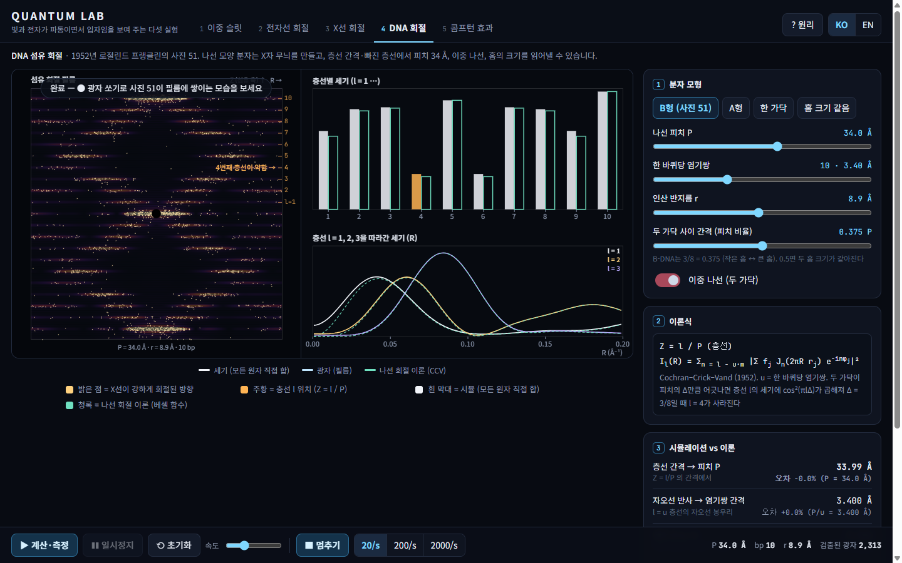
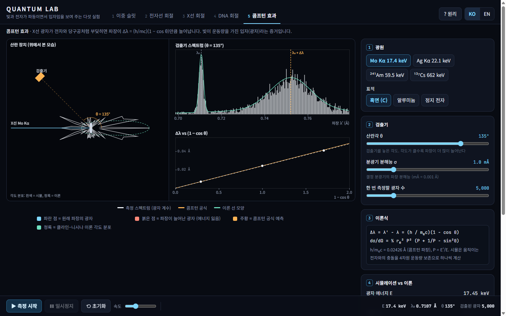

# Quantum Lab

A single-file, no-dependency browser lab with **five experiments showing that light and electrons are both waves and particles**.
Every experiment is computed from the physics itself, without drawing the expected result. Each one then measures its own output
and compares it with textbook theory in numbers.

**▶ Live demo: https://kraewon7422.github.io/quantum-slit-lab/**

A Korean guide follows the English one below.

| | Experiment | How it is simulated | What it is checked against |
|---|---|---|---|
| 1 | **Double slit** (single / double / grating, which-path) | 2-D time-dependent Schrödinger equation on the GPU | Fraunhofer and Huygens–Fresnel theory |
| 2 | **Electron diffraction** (Davisson–Germer) | The same Schrödinger solver, with an electron wave packet hitting a crystal of soft atoms | Grating equation D sinφ = λ; kinematic (1st Born) theory; the 1927 measurement (54 eV → 50°) |
| 3 | **X-ray powder diffraction** | Debye scattering equation: every atom pair in a spherical grain, Cromer–Mann form factors | Bragg's law + structure factor + Lorentz–polarisation; the Si reference pattern (ICDD 27-1402) |
| 4 | **DNA fibre diffraction** (Photo 51) | Direct sum of the waves scattered by every atom of a double helix, averaged round the fibre axis | Helical diffraction theory (Cochran–Crick–Vand 1952, Bessel functions) |
| 5 | **Compton effect** | Monte Carlo, one photon at a time: Klein–Nishina angles, 4-momentum conservation with moving bound electrons | Δλ = (h/mc)(1 − cos θ); fit of Δλ against 1 − cos θ gives h/mc |

## Why I made it

Most animations of these experiments draw the answer with a formula and sprinkle dots on top. I wanted each result to come out of
the physics, and then check it the way a lab would: measure positions and intensities from the simulated data and set them against
theory. When they don't match, the lab should show why.

## Layout

The tabs along the top choose the experiment. The left side is the apparatus and detector; the right panel holds **every setting**
(presets, sliders with a one-line meaning, instrument choices) plus the theory formula and the **simulation vs theory** numbers. The
bar at the bottom has fire / pause / reset / speed, the particle (or photon) gun and live readings.

Keys: `Space` fire / pause · `R` reset · `P` particles · `O` which-path (slit) · `1`–`5` experiments. Korean and English (`?lang=en`).
The URL hash stores the experiment and its settings, so a link reopens the same setup.

## Run

Open `quantum-slit-lab.html` (or `index.html`) in a modern browser. No install, no server, no build step. Experiments 1–2 run on the
GPU (WebGL2) and fall back to a slower CPU solver (`?cpu=1` forces it). Unit tests: append `?test=1` (37 tests).

## The physics, experiment by experiment

### 1 · Double slit
`i ∂ψ/∂t = −½∇²ψ + Vψ` (ħ = m = 1, grid spacing 1), Visscher's staggered leapfrog, which conserves probability exactly, and a
4th-order 13-point Laplacian (λ = 8 cells travels 1.2 % slow instead of 10 % with 5 points). The edges have a 32-cell absorbing band.
The screen integrates the **probability current** `j_x`, the probability of arriving, not |ψ|². Particles are drawn from that
distribution one at a time (Born rule). With which-path measurement on, each shot runs with only the measured slit open, giving
`|ψ₁|² + |ψ₂|²` statistics. Theory: `sinc²β · [sin Nα / (N sin α)]² · cos⁴θ` (Fraunhofer), plus a near-field Huygens–Fresnel sum
with the real geometry and beam.

### 2 · Electron diffraction
An electron of energy E has `λ = h/√(2meE(1 + E/2mc²))` (1.669 Å at 54 eV). The crystal is a 2-D square lattice of Gaussian
repulsive atoms, 4 layers deep, with row spacing D = 2.15 Å, nickel's surface row spacing (1 cell = 0.179 Å). A short, wide wave
packet is fired at normal incidence. After the reflection, the wave in front of the crystal is Fourier-transformed and binned by
angle `φ = atan(k_y / −k_x)`. That is the far-field angular distribution, drawn as a polar plot like Davisson and Germer's.
The **energy scan** (30 → 90 eV) repeats this to find where the first-order beam is strongest.

### 3 · X-ray powder diffraction
A spherical grain (30–80 Å across, up to ~20 000 atoms) of NaCl, KCl, Si, Cu or CsCl is built atom by atom. The pattern is the
**Debye equation** `I(q) = Σᵢⱼ fᵢ fⱼ sin(q rᵢⱼ)/(q rᵢⱼ)`: the exact orientation average over a powder, computed from the
pair-distance histogram. It uses Cromer–Mann form factors, a Debye–Waller factor and an unpolarised beam. The theory side
lists every reflection with `2d sinθ = λ`, `|F_hkl|²`, multiplicity and Lorentz–polarisation. The lab then measures peak positions,
a lattice constant and integrated intensities from the simulated curve. Reflections closer than 2.5 Scherrer widths are integrated as
one group, as in real powder work. Photons drawn from the pattern build the Debye–Scherrer rings on a 2-D detector.

### 4 · DNA fibre diffraction
A B-DNA model: phosphates at radius r, sugars at 0.7 r and four points per base pair. Ten pairs per 34 Å turn, the two strands
offset by 3/8 of the pitch, five turns (400 scatterers). The simulated film is `⟨|Σ fⱼ e^{2πi(R rⱼ cos(ψ−φⱼ) + Z zⱼ)}|²⟩_ψ`,
summed over every scatterer. The theory is the infinite-helix result: on layer line l only Bessel orders `n = l − u·m` contribute.
The lab reads the pitch from the layer-line spacing and the rise from the meridional reflection, compares the layer-line intensities,
and shows the weak 4th layer line, the clue to a double helix with major and minor grooves. Compare with the "equal grooves" and
"single strand" models.

### 5 · Compton effect
Photons (Mo Kα, Ag Kα, ²⁴¹Am, ¹³⁷Cs) scatter off graphite, aluminium or a free electron at rest. Each detected photon is a full
event. The angle is sampled from the coherent (`f(q)²` × Thomson) plus incoherent (`S(q)` × Klein–Nishina) cross sections. In an
incoherent event the electron's momentum is drawn from a Gaussian per shell, and the new energy comes from 4-momentum
conservation with a **moving** electron:
`E' = E(1 − β·n)/[(1 − β·n') + (E/γmc²)(1 − n·n')]`. The spectrometer adds its resolution. The shifted peak is found from the
spectrum without using the formula, and every finished angle adds a point to the Δλ vs (1 − cos θ) plot, whose slope is h/mc.

## Verified (`?test=1`, 37/37)

| Test | Result |
|---|---|
| Probability conservation, 2000 steps | drift 1.3 × 10⁻¹⁵ |
| Packet speed / spreading | −1.16 % / 0.003 % |
| Absorbing band reflection (λ = 6, 8, 16) | ≤ 2.6 × 10⁻⁵ |
| GPU vs CPU reference | 5 × 10⁻⁶ relative |
| Double slit fringe spacing | 60.96 vs 61.34 (0.6 %), r = 0.992 |
| Grating N = 4 / single slit first minimum | 0.2 % / 4.8 % |
| Which-path measured | visibility 0.000 (0.991 unmeasured) |
| Electron diffraction, 54 eV | peak 49.9° vs D sinφ = λ 50.9° (Davisson–Germer measured 50°) |
| Electron diffraction, 100 eV / 25 eV | 35.0° vs 34.8° / no first-order beam (0.03 % off-specular) |
| Bragg theory vs Si reference (Cu Kα) | max 0.0008° over 6 reflections |
| Structure-factor absences | Si (200), (222) ≈ 10⁻³¹; KCl (111) 0.5 %; NaCl (111) 8.7 % |
| Debye sum: Si peak positions, lattice constant | max Δ2θ 0.037°, a = 5.4332 vs 5.4309 Å (0.04 %) |
| Debye sum vs structure-factor intensities (R factor) | Si 3.0 %, NaCl 5.5 %, KCl 3.7 % |
| DNA: pitch, rise from the pattern | 33.99 Å (34), 3.400 Å (3.4) |
| DNA: I₄/I₃, layer-line match | 0.346 vs theory 0.323; r = 0.9999 |
| DNA: equal grooves / single strand | odd lines I₁/I₂ = 0.04; single strand keeps l = 4 (0.94) |
| Compton: 4-vector kinematics at rest vs formula | 8 × 10⁻¹² Å |
| Compton MC, graphite, 90° | Δλ 0.02422 vs 0.02426 Å (−0.2 %) |
| Δλ vs (1 − cos θ), 4 angles | h/mc = 0.02419 Å (0.3 %) |
| Klein–Nishina sampling | χ² = 19.5 for 17 dof |
| UI flow: every tab fires, shoots, resets (dots cleared), fires again | no errors |

## Honest notes

- **Everything is 2-D or simplified where it says so.** The Schrödinger experiments are 2-D: waves spread as cylinders, and the
  "nickel" crystal is a square lattice with nickel's surface spacing, not a real fcc (111) surface. Its strongest first-order beam is
  near 50 eV because of this lattice, not because it reproduces nickel's inner potential.
- **The X-ray intensity test was changed after it failed.** The first version required every reflection with I ≥ 10 to agree with
  theory within 15 %. Si 333/511 came out at 9 against 11 (17 %), so it failed. I switched to the crystallographer's R factor,
  Σ|I_sim − I_theory| / ΣI_theory < 8 %. That measure is standard, but the change came after the failure. Weak reflections next to
  strong ones still disagree and the table shows it: NaCl (111) is 4 in the simulation against 9 in theory. The cause is that a
  60 Å grain gives broad peaks with long tails, so a weak peak sitting on a strong neighbour's tail loses area to the background.
  Peak *positions* agree to about 0.04°, but they sit consistently about 0.04° low, a small-crystal effect.
- **Compton:** the bound-electron momenta are single Gaussians per shell, and S(q) uses the Waller–Hartree approximation with
  equivalent electrons. The shift and the slope are robust; the shape and the unshifted/shifted ratio are approximate.
- **DNA:** the model is a set of point scatterers (phosphate, sugar, four base points), not a full atomic model. The film is drawn
  in the small-angle approximation, ignoring Ewald-sphere curvature. The 4th layer line is weak (I₄/I₃ ≈ 0.35), not absent, because
  higher Bessel orders (n = l − 10) still contribute further out.
- **Slit:** the single-slit first minimum lands ~5 % out because the slit is only 3λ wide and the wall half a wavelength thick.

## References

- P. B. Visscher, Computers in Physics 5, 596 (1991) · A. Tonomura et al., Am. J. Phys. 57, 117 (1989)
- C. Davisson & L. H. Germer, Phys. Rev. 30, 705 (1927)
- P. Debye, Ann. Phys. 351, 809 (1915) · International Tables for Crystallography Vol. C, §6.1.1.4 (Cromer–Mann coefficients)
- W. Cochran, F. H. C. Crick & V. Vand, Acta Cryst. 5, 581 (1952) · R. E. Franklin & R. G. Gosling, Nature 171, 740 (1953)
- A. H. Compton, Phys. Rev. 21, 483 (1923) · O. Klein & Y. Nishina, Z. Phys. 52, 853 (1929)

## License

MIT. See [LICENSE](LICENSE).

---

## 한국어 안내

빛과 전자가 **파동이면서 입자**임을 보여 주는 다섯 실험을 한 HTML 파일에 담았습니다. 설치할 것 없이
`quantum-slit-lab.html`을 브라우저로 열면 됩니다. 실험마다 결과를 공식으로 그리지 않고 물리로 계산한 뒤, 그 결과를 직접
측정해 이론과 숫자로 비교합니다.

### 다섯 실험

1. **이중 슬릿**: 슈뢰딩거 방정식을 풀어 파동이 두 슬릿을 동시에 지나는 모습을 봅니다. 입자를 하나씩 쏘면 점이 쌓여 무늬가
   되고, 어느 슬릿을 지났는지 측정하면 무늬가 사라집니다.
2. **전자선 회절**: 같은 방정식으로 전자 파동을 결정에 쏩니다. 54 eV에서 50° 근처에 봉우리가 생기는지(데이비슨–거머, 1927)
   극좌표 그래프로 확인하고, 에너지 스캔으로 가장 강한 전압을 찾습니다.
3. **X선 분말 회절**: 결정립 속 원자 수천 개에서 산란된 X선을 모두 더해(디바이 방정식) 회절 무늬를 만들고, 브래그 법칙과
   구조 인자로 예측한 봉우리 위치와 세기를 비교합니다. KCl의 (111)처럼 사라지는 반사도 볼 수 있습니다.
4. **DNA 회절(사진 51)**: 이중 나선의 모든 산란체를 더해 X자 섬유 회절 무늬를 만들고, 층선 간격에서 피치 34 Å, 자오선
   반사에서 염기쌍 간격 3.4 Å을 읽어 냅니다. 4번째 층선이 약한 이유(두 가닥이 피치의 3/8만큼 어긋남)도 비교합니다.
5. **콤프턴 효과**: 광자를 하나씩 쏘고, 움직이는 전자와의 충돌을 4차원 운동량 보존으로 계산합니다. 여러 각도에서 측정한
   Δλ를 1 − cos θ에 대해 그리면 기울기가 콤프턴 파장 h/mc가 됩니다.

### 화면 구성

위쪽 탭으로 실험을 고릅니다. 왼쪽은 실험 장치와 검출기, 오른쪽 패널에는 모든 설정(프리셋, 뜻이 한 줄씩 붙은 슬라이더)과
이론식, **시뮬레이션 vs 이론** 숫자가 있습니다. 아래 막대에서 발사·일시정지·초기화·속도, 입자(광자) 쏘기를 합니다.

단축키: `Space` 발사/일시정지 · `R` 초기화 · `P` 입자 · `O` 경로 측정(슬릿) · `1`–`5` 실험 선택

### 테스트

주소 뒤에 `?test=1`을 붙이면 37개 테스트가 실행됩니다. 결과는 위의 Verified 표에 있습니다. X선 세기 비교는 처음에 반사별
15 % 기준으로 했다가 Si 333/511에서 실패해 R 인자 기준으로 바꿨고, 약한 반사(예: NaCl 111)는 여전히 이론과 차이가 납니다.
자세한 이유는 위의 Honest notes에 적었습니다.
