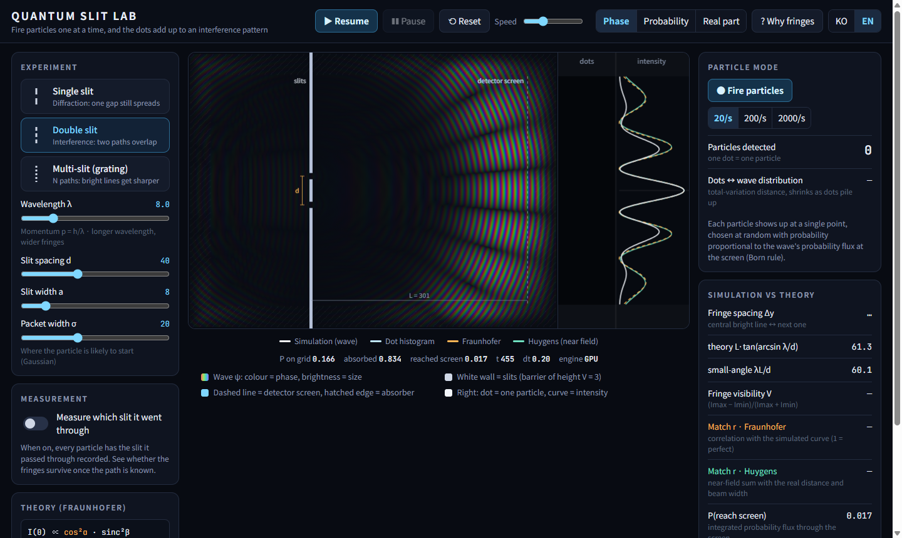
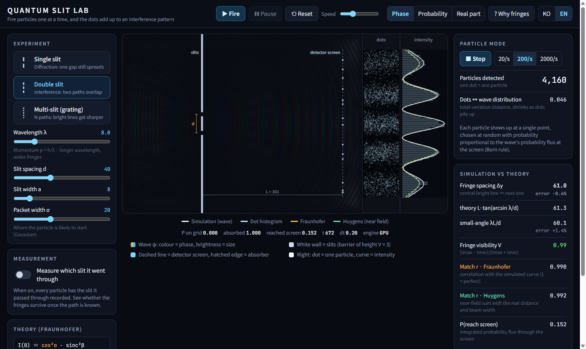

# Quantum Slit Lab

A single-file, no-dependency browser lab for the **double-slit experiment**, solved from the
Schrödinger equation itself. Fire a wave packet at a wall with slits, watch it split and interfere,
then fire particles **one at a time** and watch the dots pile up into the same fringes. Every run is
compared with diffraction theory, in numbers.

**▶ Live demo: https://kraewon7422.github.io/quantum-slit-lab/quantum-slit-lab.html**

A Korean guide follows the English one below.




## Why I made it

Most double-slit animations draw the fringes with a formula and then sprinkle dots on top. I wanted
the fringes to come out of the physics: solve the time-dependent Schrödinger equation on a grid, put a
real detector line in front of the wave, and then check, by measurement, that the result matches
what the textbooks say. When it does not match, the lab should show why.

## What you can do

| | |
|---|---|
| **Three experiments** | Single slit (diffraction), double slit (interference), multi-slit grating with N = 3–5 |
| **Sliders** | Wavelength λ, slit spacing d, slit width a, number of slits N, packet width σ |
| **Three views** | Phase colour (hue = arg ψ, brightness = \|ψ\|), probability \|ψ\|², real part Re ψ |
| **Particle mode** | Detections appear one dot at a time (20, 200 or 2000 per second); a histogram converges on the wave's curve |
| **Which-path measurement** | Record which slit each particle went through, and the fringes disappear |
| **Numbers panel** | Fringe spacing vs theory, first dark line, curve correlation with two theories, fringe visibility, probability of reaching the screen |
| **Explainer** | Four short cards: two paths at once → phase and path difference → one particle, one dot → looking destroys the fringes |
| **Share** | The URL hash stores the setup, so a link reopens the same experiment |

Keys: `Space` fire / pause · `R` reset · `P` particles · `O` measurement on/off · `1` `2` `3` experiments.
Korean and English UI (`?lang=en`).

## Run

Open `quantum-slit-lab.html` in any modern browser. No install, no server, no build step.
It runs on the GPU (WebGL2). Without float render targets it falls back to a slower CPU solver
(`?cpu=1` forces it).

Unit tests: append `?test=1` to the URL (20 tests, results on screen and in the console).

## The physics

**Equation.** The 2-D time-dependent Schrödinger equation in units ħ = m = 1, grid spacing 1:

```
i ∂ψ/∂t = −½ ∇²ψ + V ψ
```

**Integrator.** Visscher's staggered leapfrog (1991): ψ = R + iI with R stored at whole steps and I at
half steps, `R += dt·H I`, `I −= dt·H R`. Two GPU passes per step. Its discrete probability
`Σ R(t)² + I(t+dt/2)·I(t−dt/2)` is conserved exactly, and the initial state is normalised so that this
sum is exactly 1. Stable when `dt·E_max ≤ 2`; with the wall height V = 3 the code uses dt = 0.2 and
lowers dt automatically if the potential is ever higher.

**Laplacian.** A 4th-order, 13-point stencil. With the simpler 5-point stencil a packet with λ = 8 cells
travels about 10 % too slowly (lattice dispersion); with 4th order the error is 1.2 %.

**Edges.** A 32-cell absorbing band multiplies ψ by `1 − 0.05·s²` every step (s = depth into the band).
Measured reflection: below 3 × 10⁻⁵ for λ = 6, 8 and 16.

**Detector.** The screen does not record |ψ|². It integrates the **probability current** through the
screen line, `j_x = Im(ψ* ∂ψ/∂x)`, which is the probability of *arriving* there. (Accumulating |ψ|²
would over-count particles that cross the line at an angle by 1/cos θ.) A free packet sent through the
line gives Σ j_x dt = 0.995.

**Particles.** Each dot is drawn from the detector distribution by inverse-CDF sampling: the Born rule.
The total-variation distance between the dot histogram and the wave's curve shrinks as the dots pile up.

## The theory curves

Two predictions are drawn over the simulated curve:

1. **Fraunhofer (far field)**: the textbook formula
   `I ∝ sinc²β · [sin Nα / (N sin α)]²`, `α = πd sinθ/λ`, `β = πa sinθ/λ`,
   multiplied by `cos⁴θ` to turn intensity per angle into arrivals per unit length on a flat screen
   (Rayleigh–Sommerfeld obliquity cos²θ × flat-screen projection cos²θ).
2. **Huygens–Fresnel (near field)**: a direct sum over every point of the slits with the real screen
   distance, the Gaussian beam's actual amplitude at the wall and the packet's spread of wavelengths
   (2-D Rayleigh–Sommerfeld, `e^{ikr}/√r`).

The panel shows the **Fresnel number** `F = D²/(λL)` of the whole aperture. When F < 1 both curves agree;
when F > 1 (the grating) Fraunhofer drifts away and Huygens still matches. That gap is physics, not a bug.

Fringe positions are compared with the exact far-field geometry `y_m = L·tan(arcsin(mλ/d))` and with the
small-angle shortcut `λL/d`, so you can see how much the shortcut costs (1.4 % for the default double slit,
9 % for the grating).

## Which-path measurement: how it is modelled

With measurement on, every shot gives one outcome, "the particle was at slit j", with probability
proportional to the intensity reaching that slit. The particle's wave then contains only the part that
went through slit j, so the solver runs that shot with the other slits closed, and the detector
accumulates the branches weighted by their arrival probability. This gives the same statistics as a
projective measurement at the slits (`|ψ₁|² + |ψ₂|²` instead of `|ψ₁ + ψ₂|²`). An instantaneous cut of ψ
into regions was rejected, because with a ≈ λ the waves from the two slits overlap immediately and the
cut would add numerical artefacts.

## Verified (`?test=1`, 20/20)

| Test | Result |
|---|---|
| Probability conservation, 2000 steps, no absorber | drift 1.3 × 10⁻¹⁵ |
| Packet speed vs group velocity k₀ | −1.16 % |
| Packet spreading vs σ√(1 + (t/2σ²)²) | 0.003 % |
| Absorbing band reflection (λ = 6, 8, 16) | ≤ 2.6 × 10⁻⁵ |
| Flux detector, free packet | Σ = 0.995 |
| Wall opacity (closed wall, λ = 6) | 5 × 10⁻⁹ transmitted |
| Stability limit for dt (and 10 % above it diverges) | ✓ |
| Inverse-CDF sampling, 10⁵ samples | χ² = 37 for 47 dof |
| Fraunhofer zeros / peaks, Huygens → Fraunhofer at L = 60 000 | ✓, max diff 2 × 10⁻⁴ |
| GPU vs CPU reference (128×96, 400 steps) | 5 × 10⁻⁶ relative |
| Double slit fringe spacing | 60.96 vs 61.34 exact (0.6 %); small-angle 60.10 |
| Double slit curve match | r = 0.992 (Huygens), 0.990 (Fraunhofer), visibility 0.991 |
| Single slit first minimum | 111.3 vs 106.2 (4.8 %) |
| Grating N = 4 principal maxima | 120.05 vs 119.80 (0.2 %), r(Huygens) = 0.997 |
| Which-path measured | visibility 0.000 (vs 0.991 unmeasured), r = 0.999 with the incoherent theory |
| Slit geometry, colours, URL hash, KO/EN keys | ✓ |

## Honest notes

- This is a **2-D** world: waves spread as cylinders (amplitude ∝ 1/√r), not spheres. The diffraction
  formulas used are the 2-D ones.
- The single-slit first minimum lands about 5 % further out than the Fraunhofer prediction. The slit is
  only 3λ wide and the wall is half a wavelength thick, which scalar diffraction theory ignores.
- Lattice dispersion makes packets 1.2 % slower than k₀ at the default λ = 8, and more at λ = 6, so the
  wavelength slider stops at 6 cells.
- The wall is a barrier of height V = 3 rather than infinite; at the highest energy allowed, tunnelling
  through it is about 10⁻⁸.

## References

- P. B. Visscher, *A fast explicit algorithm for the time-dependent Schrödinger equation*, Computers in
  Physics 5, 596 (1991)
- A. Tonomura et al., *Demonstration of single-electron buildup of an interference pattern*, Am. J. Phys.
  57, 117 (1989)
- R. P. Feynman, *The Feynman Lectures on Physics*, Vol. III, ch. 1
- J. W. Goodman, *Introduction to Fourier Optics*, ch. 3–4 (Rayleigh–Sommerfeld, Fresnel number)

## License

MIT. See [LICENSE](LICENSE).

---

## 한국어 안내

슈뢰딩거 방정식을 직접 풀어서 **이중 슬릿 실험**을 보여주는 단일 HTML 파일입니다. 설치할 것 없이
`quantum-slit-lab.html`을 브라우저로 열면 됩니다.

### 이렇게 보세요

1. **▶ 발사**: 파속이 벽에 부딪혀 두 슬릿을 동시에 빠져나가고, 두 원형 파동이 겹쳐 줄무늬를 만듭니다.
   색은 ψ의 위상, 밝기는 크기입니다.
2. **● 입자 쏘기**: 검출 스크린에 점이 하나씩 찍힙니다. 처음엔 무작위로 보이지만, 수천 개가 모이면
   파동이 그린 무늬가 그대로 나타납니다 (보른 규칙).
3. **관측 켜기**: 입자가 어느 슬릿을 지났는지 기록하면 줄무늬가 사라지고 넓은 봉우리만 남습니다.
4. **숫자 패널**: 무늬 간격, 첫 어두운 줄 위치, 이론 곡선과의 상관계수, 줄무늬 선명도를 이론값과 비교합니다.

### 물리와 계산 방법

- 2차원 시간의존 슈뢰딩거 방정식 (ħ = m = 1, 격자 간격 1), Visscher 엇갈림 적분 (확률이 정확히 보존됨)
- 4차 정확도 13점 라플라시안: 5점을 쓰면 파속이 약 10% 느려져서 바꿨습니다
- 검출 스크린은 |ψ|²가 아니라 **확률 흐름 j_x**를 누적합니다 (실제로 스크린에 도착한 확률)
- 이론 곡선 두 개: 교과서 프라운호퍼 공식(× cos⁴θ 보정)과, 실제 거리·빔 폭까지 넣은 근거리 하위헌스 계산.
  프레넬 수 F = D²/(λL)가 1보다 크면 프라운호퍼가 어긋나고 하위헌스는 여전히 맞습니다
- 관측 모드: 매번 입자가 지난 슬릿 하나를 확률적으로 고르고, 그 실행에서는 다른 슬릿을 지나는 성분이
  없는 상태로 계산합니다 (사영 측정과 같은 통계)

### 테스트

주소 뒤에 `?test=1`을 붙이면 20개 단위 테스트가 실행됩니다. 이중 슬릿 무늬 간격 오차 0.6%, 격자 0.2%,
관측 시 선명도 0.000 등 결과는 위의 Verified 표에 있습니다.

### 단축키

`Space` 발사/일시정지 · `R` 초기화 · `P` 입자 모드 · `O` 관측 켜기/끄기 · `1` `2` `3` 실험 선택
